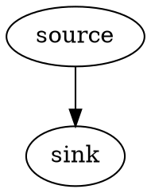
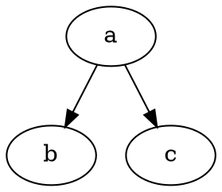
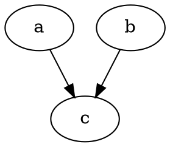
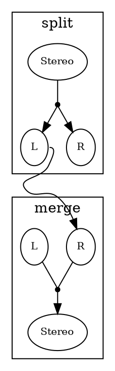
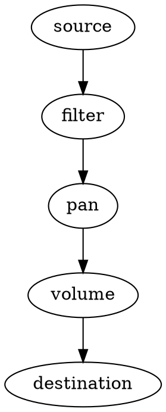
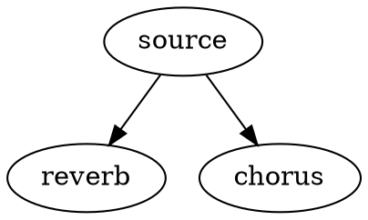
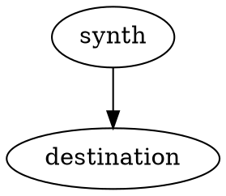

```js
source.connect(sink);
```

`connect` is used to specify how audio data should flow from one node to the next. It's analogous to "connecting a cable" from the output of one thing to the input of another. You will see the method used all over Tone.js and the Web Audio API.

## Connections are directional

Signal flows from the output of the connect-er node (aka "source") to the input of the connect-ee ("sink"). For example, this code snippet: `source.connect(sink)` could be visualized like this:



## One output can feed many inputs

Connecting a node more than once doesn't replace its earlier connections, it adds to them. Each destination gets its own copy of the signal:

```js
a.connect(b);
a.connect(c);
```



## Many outputs can feed one input

When several nodes connect to the same input, their signals are added together. This is how sounds are mixed:

```js
a.connect(c);
b.connect(c);
```



## Connections are not queryable

The connection is made at a low level within the underlying API. Neither Tone.js nor the Web Audio API explicitly retain connection data so there is no _query_ mechanism enabling you to determine something like "Is A connected to B?".

## You can connect different inputs and outputs

For nodes that have multiple inputs or outputs, `connect` can accept two additional arguments: the output number of the connect-er and the input number of the connect-ee.

To connect the left (0th) output of a splitter node to the right (1st) input of a merger node: `split.connect(merge, 0, 1)`.



## Convenience methods

Tone.js gives you a few convenience methods for connecting up nodes.

### `chain`

Use `chain` to connect a group of nodes in series.

```javascript
source.chain(filter, pan, volume, Tone.getDestination());
```



### `fan`

`fan` connects the output of a node to the inputs of all of the arguments:

```javascript
source.fan(reverb, chorus);
```



### `toDestination`

`toDestination` is shorthand for connecting a node to the [Destination](/docs/latest/getdestination/) (the speakers). It returns the node so it can be chained onto the constructor:

```js
const synth = new Tone.Synth().toDestination();
```



## Disconnecting

`disconnect` removes connections. With no arguments it removes all of a node's outgoing connections, or pass a node to remove just that one:

```javascript
source.disconnect(reverb);
```
