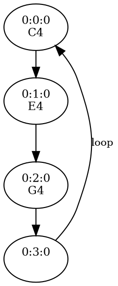

The Transport is the timekeeper and event scheduler, allowing for application-wide synchronization of sources, signals and events along a shared timeline. It can be accessed at [`Tone.getTransport()`](/docs/latest/gettransport/).

```js live
const synth = new Tone.Synth().toDestination();
// This plays a note on every quarter note:
Tone.getTransport().scheduleRepeat((time) => {
  synth.triggerAttackRelease("C4", "8n", time);
}, "4n");
Tone.getTransport().start();
```

Scheduling an event doesn't play anything by itself. The callback is invoked once the Transport is started and reaches the event, and passes in the exact `time` the note should play.

## A Shared Timeline

The Transport has a playhead that moves along a timeline measured in bars, beats and sixteenths (`"bars:beats:sixteenths"`, starting from `"0:0:0"`). Scheduling an event places it at a position on that timeline, and its callback is invoked whenever the playhead reaches that position.

When the Transport loops, or is stopped and started again, the playhead passes over the same positions again and the events fire again:

```js live
const synth = new Tone.Synth().toDestination();
const transport = Tone.getTransport();
transport.schedule(
  (time) => synth.triggerAttackRelease("C4", "8n", time),
  "0:0:0",
);
transport.schedule(
  (time) => synth.triggerAttackRelease("E4", "8n", time),
  "0:1:0",
);
transport.schedule(
  (time) => synth.triggerAttackRelease("G4", "8n", time),
  "0:2:0",
);
// loop the first measure
transport.loop = true;
transport.loopEnd = "1m";
transport.start();
```

<br>



## Callback Timing

Callbacks are passed the exact `time` of the event. If you are experiencing loose timing, double check that you are passing that time into the event that you are scheduling (see [Scheduling](/guides/tutorials/scheduling/#why-callbacks-are-passed-a-time)):

```js
Tone.getTransport().schedule(() => {
  // INCORRECT ❌
  player.start();
}, 0);
```

```js
Tone.getTransport().schedule((time) => {
  // CORRECT ✅
  player.start(time);
}, 0);
```

## Scheduling API

There are three basic methods for timing events with the Transport: `schedule`, `scheduleRepeat` and `scheduleOnce`. All three of these methods return a unique ID which can be used to cancel the callback using `clear`.

### `schedule`

`schedule` will add a callback event to a specific position along the Transport which will be invoked each time the Transport reaches that position.

```javascript
Tone.getTransport().schedule((time) => {
  // invoked when the Transport starts
}, 0);
```

### `scheduleRepeat`

Schedule an event to be invoked at the given interval, starting at `startTime` and for the specified `duration`.

```javascript
// play a note every eighth note starting from the first measure
Tone.getTransport().scheduleRepeat(
  (time) => {
    synth.triggerAttackRelease("C4", "16n", time);
  },
  "8n",
  "1m",
);
```

If no `startTime` is passed in, the interval will start at the current tick if the Transport is started, or at 0 if the Transport is stopped. If no `duration` is given, the callback will repeat infinitely.

### `scheduleOnce`

Schedule an event which will only be invoked once. After the event is invoked, it will be removed.

### `clear` / `cancel`

Each of the scheduling methods returns a unique ID. This ID can be used to cancel the event using `clear`.

```javascript
const id = Tone.getTransport().scheduleRepeat(callback, "4n");
Tone.getTransport().clear(id);
```

To remove all of the scheduled events after a given time, use `cancel`:

```javascript
// remove all events after 2 measures
Tone.getTransport().cancel("2m");
```

## Attributes

### `bpm`

Tempo-relative values (like `"1m"`) are evaluated against the Transport's bpm (beats per minute) value, which defaults to 120. `bpm` is a signal, which means that it's capable of smooth tempo-curves and automation. All callbacks scheduled with the Transport will adjust their timing to match the new tempo.

```javascript
// set the tempo
Tone.getTransport().bpm.value = 90;
// smoothly ramp the tempo to 240 bpm over 4 seconds
Tone.getTransport().bpm.rampTo(240, 4);
```

### `position` and `seconds`

The current position of the Transport can be read or set as Bars:Beats:Sixteenths with `position`, or in seconds with `seconds`.

```javascript
// jump to the third measure
Tone.getTransport().position = "2:0:0";
```

### `loop`

When `loop` is set to `true`, the Transport will loop between `loopStart` and `loopEnd`.

```javascript
Tone.getTransport().loop = true;
Tone.getTransport().loopStart = 0;
Tone.getTransport().loopEnd = "2m";
```

### `timeSignature`

The Transport is capable of any time signature, but the value will be reduced to a number over 4. So for example, 4/4 time would be set as just 4, and 6/8 time would be set as 3.

If an array is given, it will be reduced to just the numerator value over 4 (`[7, 8]` becomes just `3.5`).

### `swing`

The Transport has a `swing` attribute which is a number between 0-1. It controls how laid back the `swingSubdivision` is.

The `swingSubdivision` sets which subdivision to apply the swing to. The default value is `"8n"`. The downbeat will never be swung.
